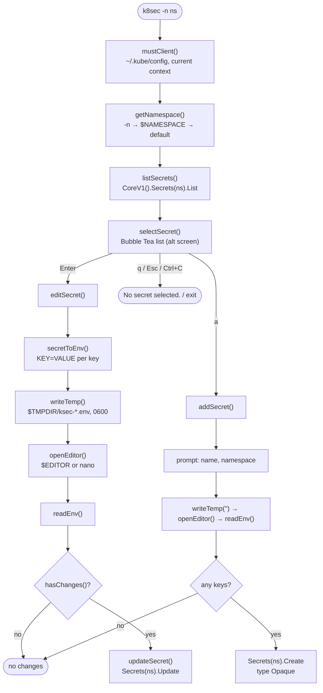

# How k8sec works

`k8sec` is a single Go `main` package (about 340 lines) built on
[`client-go`](https://github.com/kubernetes/client-go) and
[Bubble Tea](https://github.com/charmbracelet/bubbletea) /
[Bubbles](https://github.com/charmbracelet/bubbles).

## Flow



## Files

| File | Responsibility |
| --- | --- |
| `main.go` | Flag parsing, kube client, namespace selection, listing, the edit and create flows, temp file and `.env` parsing, `must()` error handling (panics on error). |
| `model.go` | The Bubble Tea model. Handles `Enter` (select), `a` (add mode) and `Ctrl+C` itself; every other key is passed to the Bubbles list (navigation, `/` filtering, `q`/`Esc` quit, `?` help). |
| `item.go` | Adapts a `v1.Secret` to a list item: title is the name, description is the namespace, filtering uses the name. |

## The edit format

`secretToEnv` writes `key=value\n` for every entry in `Secret.Data` (client-go has already
base64-decoded these bytes). `readEnv` reads the file back line by line:

- skips blank lines;
- splits on the **first** `=`; lines without `=` are skipped;
- keeps keys and values exactly as written (no trimming, no comments, no quoting).

`hasChanges` compares the key count and each value. Because each line is a whole value,
values that contain newlines can't round-trip (see the README's
[Limitations](../README.md#limitations)).

## Updating

`updateSecret` replaces `secret.Data` with the parsed map and calls `Update` with the
object it originally listed, so the request carries that object's `resourceVersion`. If
someone else changed the Secret in the meantime, the API server rejects the update with a
conflict error rather than overwriting their change:

```text
panic: Operation cannot be fulfilled on secrets "api-keys": the object has been
modified; please apply your changes to the latest version and try again
```

Your edits are discarded in that case (the temp file is removed), so run `k8sec` again and
re-apply them.

## Build metadata

`main.VERSION` and `main.BUILDTIME` default to `Development` and empty. `make build` sets
them with `-ldflags` from `git describe --tags` and the current UTC time, and `-h` prints
them.
