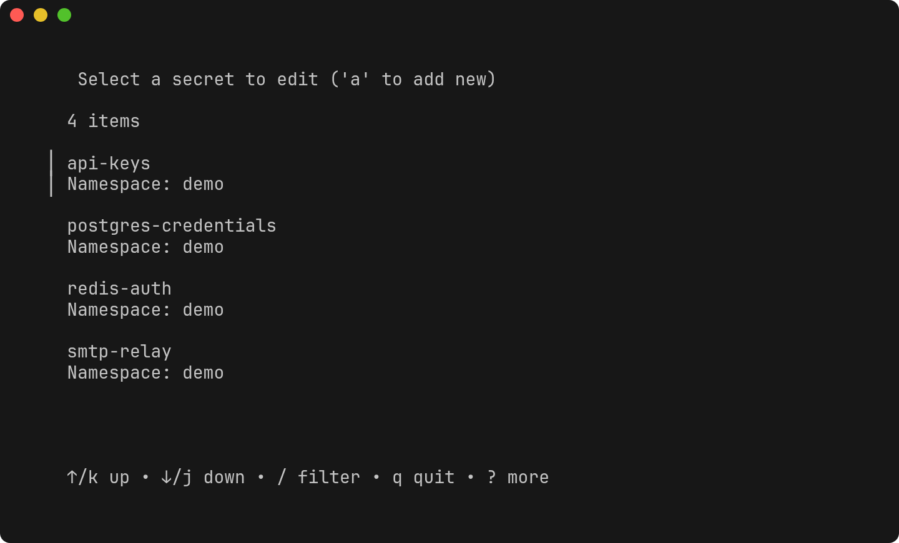
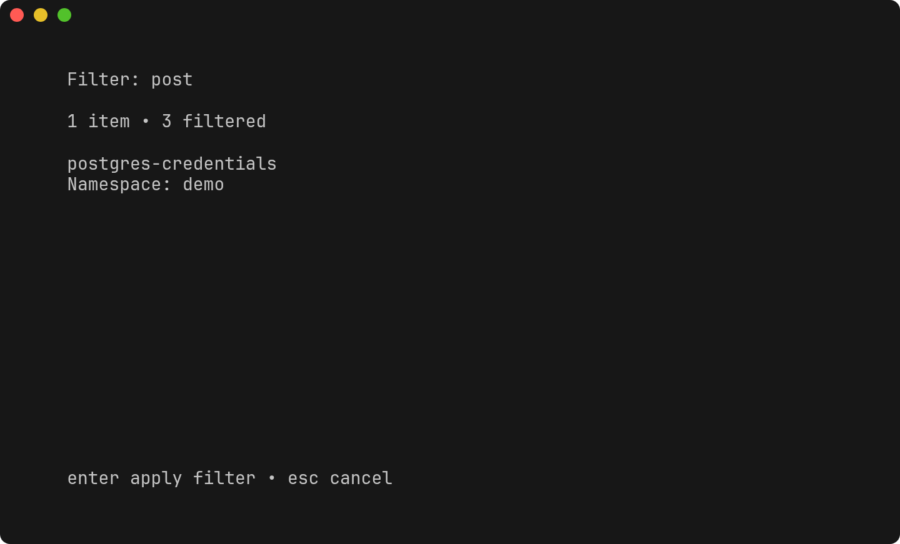
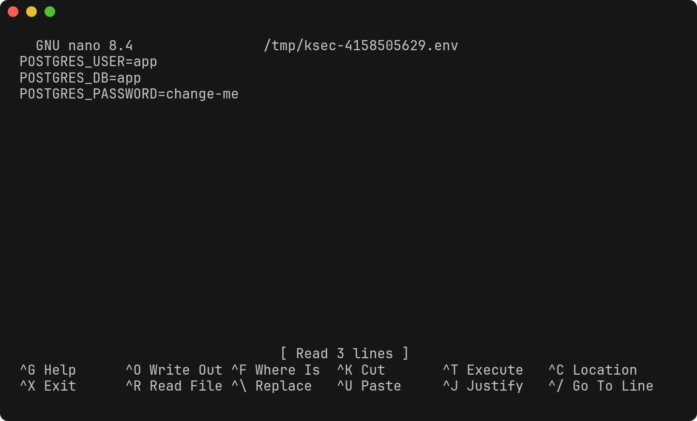

# Using k8sec

A walkthrough of the three things `k8sec` does: browse, edit and create Secrets. All the
output below is real output from `k8sec v0.0.2`. The screenshots were taken against a local
test API server with a few sample Secrets in a `demo` namespace.

## Before you start

```bash
kubectl config current-context        # k8sec uses this context from ~/.kube/config
kubectl auth can-i list secrets -n demo
kubectl auth can-i update secrets -n demo
kubectl auth can-i create secrets -n demo
```

Set your editor if you don't want `nano`:

```bash
export EDITOR=vim
```

## Browse

```bash
k8sec -n demo
```



Each entry shows the Secret name and its namespace. Move with `↑`/`↓` or `j`/`k`. Press
`q` or `Esc` to leave without doing anything; `k8sec` prints `No secret selected.`

## Filter

Press `/` and type part of a name. Matching is fuzzy, so `post` finds
`postgres-credentials`:



Press `Enter` to edit the top match straight away, or `Esc` to cancel the filter.

> Typing `a` while filtering switches to *add new Secret* mode (see
> [Limitations](../README.md#limitations)). Filter on other letters for now.

## Edit

Highlight a Secret and press `Enter`. Your editor opens a temporary file with one decoded
`KEY=VALUE` per line:



Change `POSTGRES_PASSWORD=change-me` to a new value, save and exit:

```text
Secret postgres-credentials updated.
```

Check it with kubectl:

```console
$ kubectl -n demo get secret postgres-credentials \
    -o go-template='{{range $k,$v := .data}}{{$k}}={{$v | base64decode}}{{"\n"}}{{end}}'
POSTGRES_DB=app
POSTGRES_PASSWORD=s3cure-n3w-pass
POSTGRES_USER=app
```

If you exit the editor without changing anything:

```text
no changes
```

Rules for the file:

- One `KEY=VALUE` per line. Everything after the first `=` is the value.
- Blank lines and lines without `=` are ignored.
- Delete a line to remove that key. Add a line to add a key.
- **Don't use `k8sec` on Secrets with multi-line values** (certificates, keys, JSON). They
  get truncated to their first line and written back even if you change nothing.

## Create

Press `a` in the list. `k8sec` leaves the TUI and asks for a name and namespace (press
`Enter` to accept the namespace in brackets):

```text
Enter secret name: must be lowercase alphanumeric, '-' or '_': webhook-tokens
Enter namespace [demo]:
```

Your editor opens an empty file. Add `KEY=VALUE` lines, for example:

```text
GITHUB_WEBHOOK_SECRET=whsec_example
```

Save and exit:

```text
Secret webhook-tokens created in namespace demo.
```

```console
$ kubectl -n demo get secret webhook-tokens
NAME             TYPE     DATA   AGE
webhook-tokens   Opaque   1      2s
```

Exiting with an empty file prints `no changes` and creates nothing. Kubernetes names may
only use lowercase letters, digits, `-` and `.`; despite the prompt, `_` is rejected by the
API.

## Choosing the namespace

`k8sec` picks the namespace in this order:

1. `-n <namespace>`
2. the `NAMESPACE` environment variable
3. `default`

The namespace on your kubeconfig context is **not** used. If you only have access to one
namespace, always pass `-n`. Otherwise you'll see an error like:

```text
panic: secrets is forbidden: User "system:serviceaccount:demo:k8sec-user" cannot list resource "secrets" in API group "" in the namespace "default"
```

## Troubleshooting

| Message | Cause | Fix |
| --- | --- | --- |
| `panic: stat /home/you/.kube/config: no such file or directory` | No kubeconfig at the default path | Create `~/.kube/config` or copy/symlink your kubeconfig there |
| `panic: ... is forbidden: ... cannot list resource "secrets"` | Missing RBAC or wrong namespace | Pass `-n`, or see [permissions.md](permissions.md) |
| `panic: exec: "nano": executable file not found in $PATH` | `EDITOR` unset and `nano` not installed | `export EDITOR=vim` (or install nano) |
| `panic: exec: "code --wait": executable file not found` | `EDITOR` contains arguments | Point `EDITOR` at a wrapper script |
